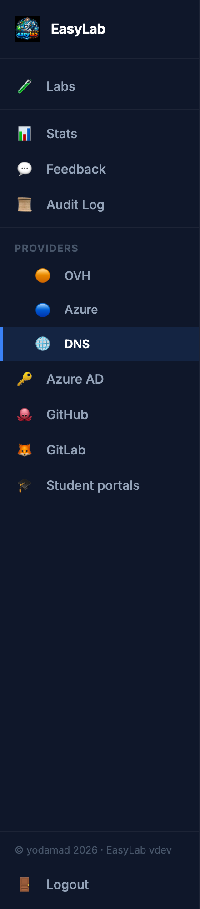
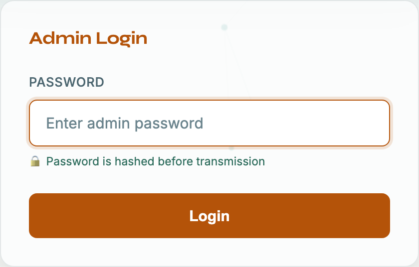
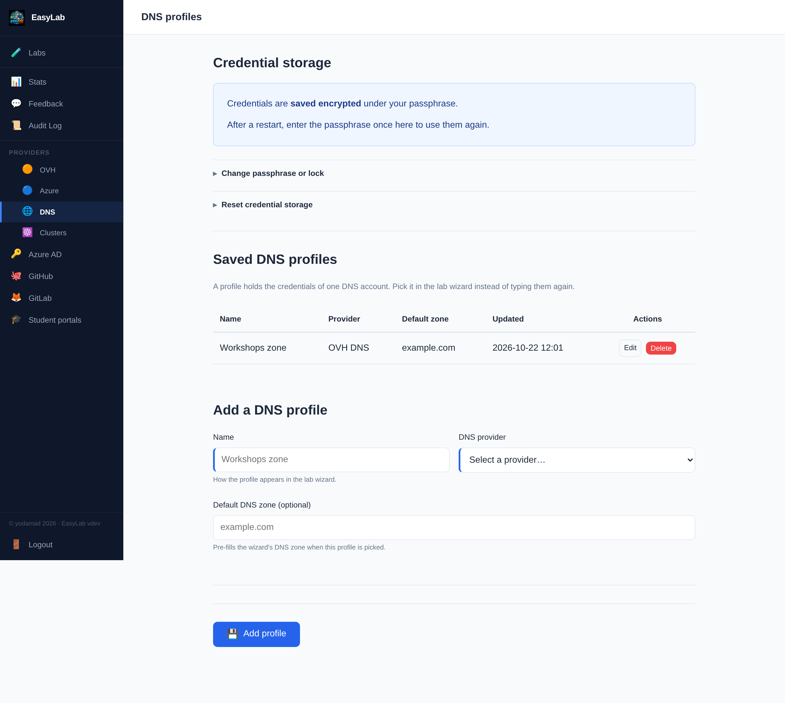
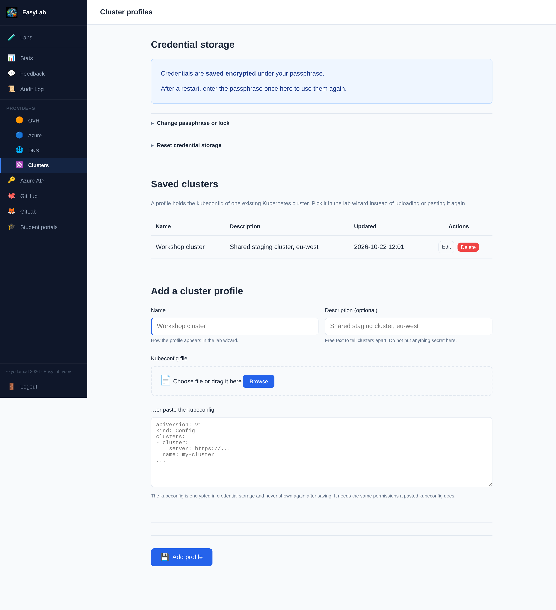
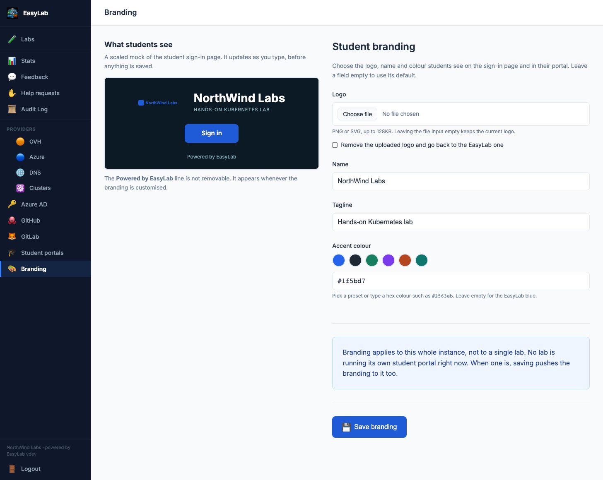

# Admin Space

{ width=200 }

As an admin (trainer, speaker, ...), you have access to the admin space to manage your labs:

* [x] [Create a new lab](admin-lab-creation.md)
* [x] Define multiple workspace templates per lab (students get one workspace per template)
* [x] Dry run (preview) a lab before creating it
* [x] Set/update credentials for the cloud providers
* [x] [Manage your labs](admin-lab-management.md)
    * [x] See logs
    * [x] Retrieve endpoint info (workspace base URL, namespace) for completed labs
    * [x] Delete a lab
    * [x] Recreate a destroyed lab, either as-is or with an edited configuration
    * [x] List workspaces
    * [x] Delete workspaces (one by one or in bulk)
    * [x] See a workspace creation/deletion history per lab, with owner and template
    * [x] Export a lab's workspace history to CSV
    * [x] Retry a failing lab installation, either as-is or with an edited configuration
* [x] View student feedback per lab (rating, difficulty, comments)
    * [x] Export a lab's feedback to CSV
* [x] View deployment statistics (KPIs, monthly chart, per-project breakdown)
* [x] Configure automatic workspace and lab deletion (cleaning policies)
* [x] View an audit log of lab, workspace, and credential actions ([details](audit-log.md))
* [x] [Brand the student portal](#branding) with your own logo, name, tagline and accent colour

Every admin page shows the EasyLab copyright and version in the sidebar footer. The version reflects the latest Git tag the binary was built from (`dev` for local/untagged builds).

## Login

Admin login uses the password set via `LAB_ADMIN_PASSWORD` (or Azure AD, if configured — see [Azure AD authentication](azure-ad.md)). After 5 failed password attempts, further attempts from the same client are locked out for 15 minutes as a brute-force protection. The admin and student login forms keep separate counters, so failures on one never lock the other. Behind a reverse proxy the client is identified by the proxy's `X-Forwarded-For` (last hop) or `X-Real-IP` header, under the same trust setting as `TRUST_FORWARDED_PROTO` (see [Docker — Environment Variables](docker.md#environment-variables)).

The login page follows your system's light or dark preference; the sun/moon button in the top-right corner switches theme, and the choice is shared with the homepage.

{ width=300 }

Student login can additionally be opened to Microsoft accounts ([Azure AD authentication](azure-ad.md)) GitHub accounts ([GitHub login](github.md)), or GitLab accounts on gitlab.com or a self-managed instance ([GitLab login](gitlab.md)); each is configured from its own entry in the admin sidebar.

## Provider credentials

Cloud provider credentials and options are accessed from the **Provider** dropdown in the header. It contains two entries:

* **OVH** — opens the OVH configuration page (`/admin/ovh-options`)
* **Azure** — opens the Azure configuration page (`/admin/azure-options`)

Each provider page has two tabs:

* **Credentials** — enter and save the API credentials for the provider. Credentials are **never written to lab state on disk**: they are re-read from the credential store whenever a lab is destroyed, recreated, or retried, so they must be available at that time. By default they are kept in memory only and cleared on application restart; to keep them across restarts, either set up [credential storage](#credential-storage) or provide them through the `OVH_*` / `AZURE_*` environment variables. When using **Use Existing Cluster**, no cloud credentials are required.
* **Options** — configure available regions and compute flavors/VM sizes for the lab creation wizard. Use **Refresh** to fetch the latest data from the provider API.

For OVHcloud-specific setup, see [OVHcloud configuration](ovhcloud.md). For Azure-specific setup, see [Azure configuration](azure.md).

## Credential storage

EasyLab can keep cloud provider credentials and [DNS profiles](#dns-profiles) across restarts, encrypted with AES-256-GCM. It only ever does so under a key that is **not stored next to the data**, so a leaked data volume or backup does not expose them. The **Credential storage** card at the top of the **DNS** page (and of `/credentials`) shows which of these applies:

| What you see | Meaning |
|--------------|---------|
| **In memory only** | Nothing is saved. Credentials are cleared when EasyLab restarts. This is the default. |
| **Saved encrypted under your passphrase** | You set a passphrase on this page. It is never written to disk: after a restart the card shows **locked**, and you enter the passphrase once to get every saved credential back. |
| **Saved encrypted under `LAB_DATA_ENCRYPTION_KEY`** | The key is set in the environment, so saved credentials are available again automatically after a restart. No passphrase is involved. |
| **Cannot be read** | The credentials were saved under a `LAB_DATA_ENCRYPTION_KEY` that is no longer set (or the file is damaged). Restart with the original key, or reset. |

To start saving credentials, either:

* **Set a passphrase** — on the **DNS** page, type a passphrase of at least 12 characters twice and click **Save credentials encrypted**. Whatever you already entered in this session is saved with it. The passphrase cannot be recovered if lost.
* **Set `LAB_DATA_ENCRYPTION_KEY`** in the environment (see [Docker — Environment Variables](docker.md#environment-variables)). This suits unattended deployments: nobody has to unlock anything after a restart.

EasyLab never generates a key for itself. Earlier versions wrote one to `<DATA_DIR>/.encryption_key` to encrypt persisted job files, but a key sitting beside the data it protects is no protection, so that key was never used for credential storage — and is no longer generated at all. With a data directory configured, `LAB_DATA_ENCRYPTION_KEY` is required and the server will not start without it (see [Docker — Environment Variables](docker.md#environment-variables), which also covers upgrading a data directory that still holds that file).

While credential storage is **locked**:

* Saved cloud credentials and DNS profiles are unavailable; the lab wizard warns at the top of the page, and links to the DNS page.
* Existing labs are unaffected. Each lab carries its own copy of the DNS credentials it was created with, so retry and destroy on a BYO-cluster lab keep working. Operations that need cloud credentials (destroy, recreate, automatic lab deletion on a provisioned cluster) wait until you unlock, exactly as they waited for credentials to be re-entered before.
* Five wrong passphrases in a row pause unlocking for one minute.

Under **Change passphrase or lock** you can change the passphrase (the current one is required) or **Lock now**. Locking makes saved DNS profiles unavailable until the next unlock; cloud credentials already loaded stay in memory until EasyLab restarts.

**Reset credential storage** deletes every saved cloud credential and DNS profile. It is the only way out of a forgotten passphrase. Type `RESET` to confirm.

!!! note "Saved credentials take precedence over environment variables"
    If credentials are both provided through `OVH_*` / `AZURE_*` variables and saved from the UI, the saved ones are used once credential storage is open.

## DNS profiles

A DNS profile is a named, saved set of DNS provider credentials. Create one per DNS account (or per zone) on the **DNS** page in the sidebar, then pick it in the lab wizard instead of typing the credentials for every lab.

To add a profile:

1. Open **DNS** in the admin sidebar.
2. Under **Add a DNS profile**, enter a **Name** — this is what the lab wizard shows.
3. Choose the **DNS provider** (OVH DNS or Azure DNS). The credential fields for that provider appear.
4. Optionally enter a **Default DNS zone**; it pre-fills the wizard's DNS zone when the profile is picked.
5. Fill in the credentials and click **Add profile**.

The credentials required are the same as in the wizard — see [OVH DNS and Azure DNS credentials](admin-lab-creation.md#externaldns-optional).

**Edit** changes a profile. Secret fields are never shown again: leave them blank to keep the saved value, or type a new one to replace it. **Delete** removes the profile. Neither affects labs already created, which keep the credentials they were created with — to move an existing lab to new credentials, retry or recreate it with the profile selected.

Profiles follow the [credential storage](#credential-storage) rules above: without a passphrase or `LAB_DATA_ENCRYPTION_KEY` they last until EasyLab restarts.

## Cluster profiles

A cluster profile is a named, saved kubeconfig for an existing Kubernetes cluster. Create one per cluster on the **Clusters** page in the sidebar, then pick it in the lab wizard instead of uploading or pasting the kubeconfig for every lab on that cluster.

To add a profile:

1. Open **Clusters** in the admin sidebar.
2. Under **Add a cluster profile**, enter a **Name** — this is what the lab wizard shows.
3. Optionally enter a **Description** to tell clusters apart. It is stored in the clear, so do not put anything secret in it.
4. Upload a kubeconfig file or paste its content, then click **Add profile**.

The kubeconfig is checked for validity before it is saved, and needs the same permissions as one provided directly in the wizard — see [Use Existing Cluster](admin-lab-creation.md#use-existing-cluster).

**Edit** changes a profile. The kubeconfig is never shown again: leave both kubeconfig fields empty to keep the saved one, or provide a new one to replace it. **Delete** removes the profile. Neither affects labs already created, which keep the kubeconfig they were created with — to move an existing lab to a new kubeconfig, retry or recreate it with the profile selected.

!!! warning "A kubeconfig is usually a cluster-admin credential"

    Saved kubeconfigs are encrypted with AES-256-GCM in credential storage and are never written anywhere else, never returned to the browser, and never recorded in the [audit log](audit-log.md). They follow the [credential storage](#credential-storage) rules above: without a passphrase or `LAB_DATA_ENCRYPTION_KEY` they last until EasyLab restarts, and while storage is locked the **Clusters** page lists the profile names but cannot use them.

## Branding

By default the student portal is EasyLab-branded. On the **Branding** page in the sidebar you can put your own workshop, company or client identity on the pages your students see: a **logo**, a **name**, a **tagline** and an **accent colour**.

To brand the student portal:

1. Open **Branding** in the admin sidebar.
2. Upload a **logo** — PNG or SVG, up to 128 KB. Leaving the file field empty keeps the logo already saved; tick **Remove the uploaded logo** to go back to the EasyLab one.
3. Enter a **Name** (up to 40 characters) and a **Tagline** (up to 80 characters). Both are optional, and an empty field is not filled in with EasyLab's own wording once you have branded anything:
    * **No name, with a logo** — the logo stands alone, which is usually what you want: most logos already contain the name, and printing it again next to them doubles it up. Give a name anyway if your logo is a symbol rather than a wordmark, or if you want the browser tab and screen readers to say what the portal is: without one, the tab still reads *EasyLab* and the logo carries no text alternative, because EasyLab has no way to know what your mark is called.
    * **No tagline** — nothing is printed in its place. EasyLab's *Cloud Lab Infrastructure Platform* appears only while the instance is completely unbranded.
4. Pick an **accent colour** from the preset swatches, or type a hex value such as `#2563eb`. Leave it empty for the EasyLab blue.
5. Click **Save branding**.

The preview on the left of the page tracks what you type and pick, so you can see the student sign-in lockup before saving.

What changes: the logo, name and tagline on the student sign-in page and in the student portal header, the browser tab title, and the accent colour — the sign-in button, its focus rings and the *Student Portal* label, plus the buttons, links and header in the portal itself. What does not change: the admin space and the public homepage still look like EasyLab, so you can always tell which product you are administering.

The sign-in lockup also resizes itself once you brand it. EasyLab's own is built for a square logo and the seven letters of *EasyLab*; a real brand usually has a wide logo and a longer name, so a branded lockup caps the logo's width as well as its height, drops EasyLab's teal glow from it, and sets the name at a size that still fits on a phone.

Branding is **instance-wide** — there is no per-lab branding. Saving also pushes the branding to every lab that runs its own [in-lab student portal](student-portal.md) in its own cluster; those portals pick it up within about ten seconds, without restarting and without signing any student out.

Two details worth knowing:

* **EasyLab attribution stays.** A branded portal's footer reads `<your name> · powered by EasyLab v<version>` instead of the EasyLab copyright, and the sign-in page gains a small *Powered by EasyLab* line. This is not configurable.
* **Light accent colours are darkened.** The accent carries white button and header text, so if the colour you pick is too light for that to stay readable, EasyLab darkens it until it is and says so on the page.
* **Your name is not painted in your accent.** The accent is only guaranteed readable with white text on top of it, which is what that check measures — a dark navy or deep green would disappear if the name were set in it. Your logo carries the brand colour, the accent carries the button and the labels, and the name is set in plain legible type.

Branding is stored unencrypted in `branding.json` in the data directory — a logo, a name, a tagline and a colour are not secrets, so unlike credentials and profiles they survive a restart with no passphrase.

## Where to go next

* [Creating a Lab](admin-lab-creation.md) — the lab creation wizard: infrastructure, workspace templates, HTTPS/DNS, and cleaning policies.
* [Managing Labs](admin-lab-management.md) — the labs list, the lab detail page, retry/recreate, templates on a lab, pre-baking, workspace history, and lab credentials.
