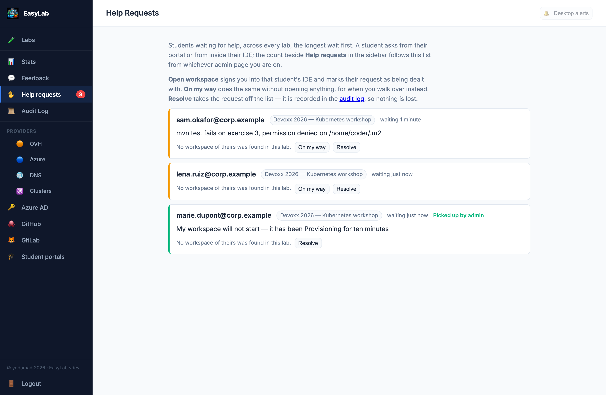

# Help Requests

During a workshop several students get stuck at once. Rather than waiting for a hand in the
air, a student can **raise a help request** from their [student portal](student.md#ask-for-help)
or from inside their IDE. EasyLab collects every open request, across all your labs, into one
queue, and lets you jump straight into the student's workspace to help.

## The sidebar item

**Help requests** is in the admin sidebar. A count badge beside it shows how many students are
waiting right now. The badge follows the queue from whichever admin page you are on, so you do
not have to be looking at the queue to notice a new request.

## The queue

Open **Help requests** to see everyone who is waiting, across every lab on this instance.
The student who has waited longest is first. Each row shows:

* **The student** — their sign-in email (or username, when only that is known)
* **The lab** — a link to the lab's [detail page](admin-lab-management.md#the-lab-detail-page)
* **How long they have been waiting**
* **Their note**, if they wrote one
* **Where it came from** — *from their IDE* is shown when the student asked from inside code-server rather than from the portal
* **Who has picked it up**, once someone has (*Picked up by …*)

{width=850}

When nobody is waiting, the page says so.

## Answering a request

Each row has up to three buttons:

* **Open workspace** — signs you into the student's IDE in a new tab, and marks the request as
  being dealt with at the same time, so you do not have to say so twice. The student's own
  button changes to *Help on the way*, and they are told, as for any
  [teacher access](student.md#my-workspaces), that a teacher opened their workspace. The
  button is only offered when a workspace of theirs was found in the lab; otherwise the row
  says *No workspace of theirs was found in this lab.*
* **On my way** — marks the request as being dealt with without opening anything. Use it when
  you walk over to the student instead. The button disappears once the request is picked up.
  If another admin picked it up first, theirs stays: the first to take a request keeps it.
* **Resolve** — the request is dealt with and leaves the queue.

Resolving removes the request; there is no "resolved" list to tidy. The
[audit log](audit-log.md) keeps the history of who asked, who picked it up and who resolved it.

## Desktop alerts

Help requests can also pop up as a desktop notification, so you find out even when EasyLab is
behind your slides. It is opt-in, per browser: press the **bell** on the Help requests page
once and allow notifications when your browser asks. The bell shows whether alerts will
actually arrive (it is greyed out when your browser has blocked notifications for this
site, or does not offer them). From then on, a student starting to wait pops up over
whatever you are doing, as long as an EasyLab admin tab is open somewhere. Each request is
announced once per browsing session. Without alerts you still have the sidebar count, which
refreshes every 20 seconds or so.

## What to expect

* **A request expires on its own after four hours.** A request nobody answered does not sit in
  the queue for ever, or in the lab's data once the workshop is over.
* **A student has at most one open request per lab.** Asking again refreshes their note and
  the time they asked, but it does not add a row, and it does not undo you having picked it
  up. One impatient student cannot bury everyone else.
* **A student can ask even if their workspace never started.** Nothing requires them to have
  one. Their row just has no **Open workspace** button.
* **Students' notes are plain text, up to 300 characters.**
* **Labs with their own student portal are a little slower.** A request raised on a lab's own
  [student portal](student-portal.md) is collected from that lab's cluster, so it arrives
  within about half a minute rather than instantly. The collection runs while someone has an
  admin page open, so it costs nothing when nobody is looking. Requests raised on this
  instance's own student area, or from a workspace's IDE on a lab without a portal, appear
  at once.

!!! note "The student's note is not in the audit log"
    The audit log records that a request was raised, picked up, withdrawn or resolved, never
    what the student wrote.
